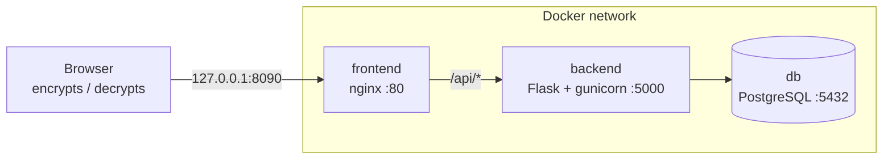

# Password Manager

A self-hosted, zero-knowledge password vault. A vanilla JS frontend (served by nginx) encrypts everything in the browser and talks to a Flask REST API backed by PostgreSQL. The whole stack starts with one command.

The server never sees your master password or your data in plain text: it stores ciphertext only.

## Features

- Store accounts (site, URL, username, email, password, notes) in an encrypted vault
- Master password with client-side encryption (AES-256-GCM, key derived with PBKDF2 + HKDF)
- Password generator (cryptographically random, no modulo bias)
- Search, edit, delete, show/hide, copy to clipboard (cleared after 20 s)
- Auto-lock after 5 minutes of inactivity
- Login rate limiting (5 failed attempts per minute per IP)
- Arabic RTL interface, responsive on mobile
- Strict Content-Security-Policy, safe DOM rendering (no XSS), parameterized SQL
- Automated tests and a CI pipeline on every push

## How the encryption works

```
master password
   └─ PBKDF2-SHA256, 600,000 iterations, random salt ─► master key
         ├─ HKDF "vault-enc"  ─► AES-GCM key   (never leaves the browser, non-extractable)
         └─ HKDF "vault-auth" ─► auth key      (sent to the server, which stores only a hash of it)
```

- Each entry is a JSON object encrypted with AES-GCM and a fresh random IV, then uploaded as one base64 blob.
- The server can verify a login (it compares the auth key with its hash) but cannot derive the encryption key from it.
- Search and filtering happen in the browser after decryption.
- A successful login returns a signed session token (30 minutes). It is kept in memory only, never in `localStorage`.

**There is no password recovery.** If the master password is lost, the data cannot be decrypted by anyone, including you.

## Architecture



Only the frontend port is published, and only on `127.0.0.1`. Browsers expose `crypto.subtle` only on `localhost` or HTTPS, so for remote access put a TLS-terminating reverse proxy in front.

## Tech stack

| Layer | Technology |
|---|---|
| Frontend | HTML, CSS, vanilla JavaScript, WebCrypto, nginx |
| Backend | Python, Flask, gunicorn, psycopg2 |
| Database | PostgreSQL 16 |
| Infrastructure | Docker, Docker Compose |
| CI | GitHub Actions, pytest, Node |

## Quick start

Requirements: Docker with the Compose plugin.

```bash
git clone <your-repo-url> password-manager
cd password-manager

cp .env.example .env
sed -i "s/^DB_PASSWORD=.*/DB_PASSWORD=$(openssl rand -hex 16)/" .env
sed -i "s/^SECRET_KEY=.*/SECRET_KEY=$(openssl rand -hex 32)/" .env

docker compose up -d --build
```

Open <http://localhost:8090>. On first visit you create the vault by choosing a master password (at least 12 characters).

```bash
docker compose down        # keeps the data
docker compose down -v     # also deletes the database volume (the vault is gone)
```

## Project structure

```
.
├── docker-compose.yml
├── .env.example                 # DB_PASSWORD, SECRET_KEY
├── .github/workflows/ci.yml     # backend tests, crypto tests, Docker smoke test
├── database/
│   └── init.sql                 # vault + entries tables
├── backend/
│   ├── app.py                   # Flask REST API
│   ├── tests/                   # pytest suite
│   ├── requirements.txt
│   └── Dockerfile
└── frontend/
    ├── index.html
    ├── css/
    ├── js/
    │   ├── crypto.js            # key derivation, AES-GCM, password generator
    │   ├── api.js               # fetch wrapper
    │   └── app.js               # UI logic
    ├── tests/crypto.test.js
    ├── nginx.conf               # static files + /api proxy + security headers
    └── Dockerfile
```

## API

Base path: `/api`. Entry payloads are opaque base64 blobs; the server does not interpret them.

| Method | Endpoint | Auth | Description | Success |
|---|---|---|---|---|
| GET | `/health` | no | Liveness check | `200` |
| GET | `/vault` | no | `{initialized, salt, iterations}` | `200` |
| POST | `/vault` | no | Create the vault `{salt, iterations, auth_key}` (once) | `201`, `409` if it exists |
| POST | `/login` | no | `{auth_key}` → `{token, expires_in}` | `200`, `401`, `429` |
| GET | `/entries` | Bearer | List encrypted entries (newest first) | `200` |
| POST | `/entries` | Bearer | `{data}` | `201` |
| PUT | `/entries/<id>` | Bearer | `{data}` | `200` |
| DELETE | `/entries/<id>` | Bearer | Delete | `204` |

Errors return `{"error": "..."}` with `400`, `401`, `404`, `409` or `429`.

## Testing

Backend tests run against a real PostgreSQL instance; the crypto tests only need Node 20+.

```bash
# backend
docker run --rm -d --name testdb -e POSTGRES_DB=vaultdb -e POSTGRES_USER=vaultuser \
  -e POSTGRES_PASSWORD=vaultpass -p 127.0.0.1:5439:5432 postgres:16

cd backend
python3 -m venv venv && source venv/bin/activate
pip install -r requirements-dev.txt
cp .env.example .env
pytest -v
cd ..
docker rm -f testdb

# frontend crypto
node frontend/tests/crypto.test.js
```

## CI

On every push and pull request, GitHub Actions:

1. Runs the pytest suite against a PostgreSQL service container.
2. Runs the crypto tests (round trip, tamper detection, wrong key, key formats expected by the API).
3. Builds the Compose stack, waits for the API through nginx, checks the vault endpoint and that `/api/entries` returns `401` without a token, then tears it down.

## Operations cheat sheet

```bash
docker compose ps -a
docker compose logs -f backend
docker compose up -d --build backend
docker exec -it vaultdb psql -U vaultuser -d vaultdb
```

Backup: `docker exec vaultdb pg_dump -U vaultuser -Fc vaultdb > backup.dump`. The dump contains only ciphertext, but keep it private anyway.

## Limitations and roadmap

- Single user, single vault
- No master password change yet (it would require re-encrypting every entry)
- Login throttling is in memory, which is why gunicorn runs one worker with threads
- [ ] Master password change (re-encrypt all entries in the browser)
- [ ] Encrypted export / import
- [ ] Optional two-factor authentication
- [ ] Push images to Docker Hub from CI
